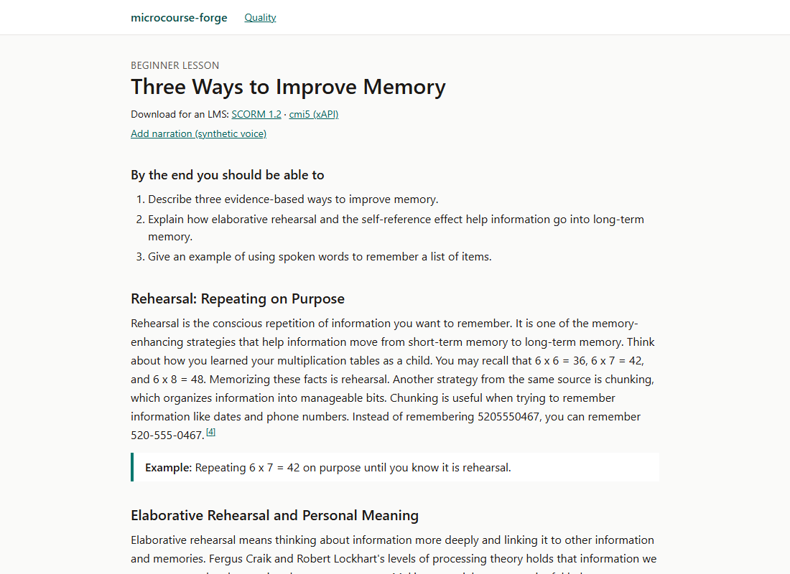
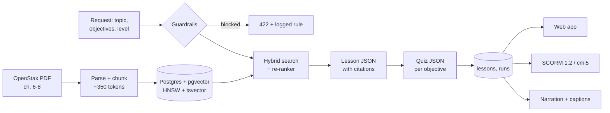
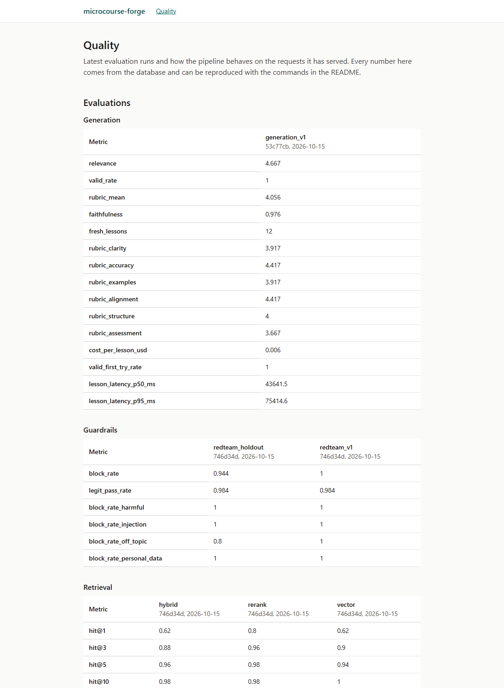

# microcourse-forge

[](https://github.com/dborrego03/microcourse-forge/actions/workflows/ci.yml)
[](https://github.com/dborrego03/microcourse-forge/actions/workflows/evals.yml)

Turns an open-licensed psychology textbook into short micro-courses: a lesson that cites the
passages it relies on, a quiz tied to its objectives, optional narration, and SCORM 1.2 or cmi5
packages for an LMS. The point is not the generator itself but showing that its quality is
measured: retrieval, faithfulness, pedagogy and guardrails all have evals, and CI fails when
they drop.

Personal portfolio project, built from scratch on public data.



## How it works



1. **Corpus.** Chapters 6-8 of OpenStax *Psychology 2e* (CC BY-NC-SA 4.0), split by the PDF's own
   section outline into 190 overlapping chunks. Each chunk keeps its section and PDF pages.
2. **Retrieval.** Local embeddings (`bge-small-en-v1.5`), vector and full-text search fused with
   reciprocal rank fusion, then re-ranked by a small cross-encoder. Nothing here calls an API.
3. **Guardrails.** Regular expressions for prompt injection, harmful intent and personal data, a
   relevance threshold for off-topic requests, and a small model as a second screen. Blocked
   requests are never stored.
4. **Generation.** The lesson and the quiz are JSON validated against Pydantic models. The sources
   are passed in as untrusted, delimited data, and every section must cite source ids that were
   actually provided. One retry tells the model what failed.
5. **Observability.** Every step is a row in `runs` (tokens, estimated cost, latency, retries,
   cache hit, commit) and an OpenTelemetry span, viewable in Jaeger locally or in Langfuse.
6. **Delivery.** A minimal Next.js app, SCORM 1.2 and cmi5 exports, narration with captions, an
   MCP server and a bounded agent that plans whole courses.

## Metrics

<!-- metrics:start -->
**Retrieval** · retrieval_v1, 50 questions · `uv run python -m forge.evals retrieval --mode <mode>`

| Mode | hit@1 | hit@5 | MRR@10 | p50 latency | Commit |
|---|---|---|---|---|---|
| vector | 0.62 | 0.94 | 0.761 | 11 ms | 746d34d |
| hybrid | 0.62 | 0.96 | 0.764 | 16 ms | 746d34d |
| rerank | 0.8 | 0.98 | 0.878 | 953 ms | 746d34d |

**Generation** · generation_v1, 12 lessons · generator claude-haiku-5-5, judge claude-sonnet-5-5 · commit 53c77cb · `FORGE_LLM_CACHE=off uv run python -m forge.evals generation`

| Metric | Value |
|---|---|
| Valid JSON on the first try | 1.0 |
| Faithfulness (claims backed by the cited sources) | 0.976 |
| Relevance (1-5) | 4.667 |
| Pedagogical rubric, mean of 6 criteria (1-5) | 4.056 |
| Estimated cost per lesson (API list prices) | $0.006 |
| Latency per lesson, p50 / p95 | 43.6 s / 75.4 s |

**Guardrails** · `uv run python -m forge.evals guardrails --dataset <dataset>`

| Attack set | Attacks | Blocked | Legitimate requests let through | Commit |
|---|---|---|---|---|
| redteam_v1 | 30 | 1.0 | 0.984 | 746d34d |
| redteam_holdout | 18 | 0.944 | 0.984 | 746d34d |

The rules were written while looking at redteam_v1; the holdout set was written afterwards.

**Judge vs. human labels** · not labelled yet (see `evals/README.md`).
<!-- metrics:end -->

These tables are generated from `evals/results/` by `uv run python -m forge.report --write`, and
CI fails if they don't match. Things to keep in mind when reading them:

- The datasets are small (50 questions, 12 lessons). One case is 0.02 of retrieval and 0.08 of
  generation.
- Faithfulness and the rubric come from an LLM judge that hasn't been checked against human
  labels yet.
- Latency was measured on a laptop CPU. Generation goes through the Claude Code CLI, which adds a
  few seconds of start-up per call compared with the API.
- `/quality` in the web app shows the same evals plus live latency, cost and cache figures from the
  `runs` table.



What changed the numbers, and why, is in [docs/log.md](docs/log.md): the lesson prompt rewrite
that took faithfulness from 0.90 to 0.98, the re-ranker choice, and the guardrails that failed
their held-out set until a second layer was added.

## Decisions

- [ADR-001](docs/adr/0001-stack.md): Python + FastAPI for the core, Next.js for the UI, one
  Postgres with pgvector instead of a separate vector database.
- [ADR-002](docs/adr/0002-llm-provider.md): Claude through the Claude Code CLI for local work and
  evals (no API bill), the Anthropic API for anything deployed.
- Hybrid search alone didn't beat vector search on this corpus; the re-ranker did, at about 1 s per
  query, so it is the default for lessons but not for everything.
- The agent only plans. Generation is a fixed pipeline, and the code enforces the lesson count,
  spending cap, time cap and two human approvals.

## Running it

You need Docker, [uv](https://docs.astral.sh/uv/) and Node 24. The book is downloaded once (see
[docs/corpus.md](docs/corpus.md)); its SHA-256 is checked.

```
docker compose up -d
cd apps/api
uv sync
uv run alembic upgrade head
uv run python -m forge.ingest --url https://assets.openstax.org/oscms-prodcms/media/documents/Psychology2e_WEB.pdf
uv run python -m forge.serve            # API on http://127.0.0.1:8000
```

```
cd apps/web
npm ci
npm run dev                             # http://localhost:3000
```

Generating lessons needs the [Claude Code CLI](https://code.claude.com) logged in, or
`FORGE_LLM_PROVIDER=anthropic` with `ANTHROPIC_API_KEY`. Narration needs `OPENAI_API_KEY`. Copy
`.env.example` to `.env` for the optional settings.

Other entry points, all from `apps/api`:

| Command | What it does |
|---|---|
| `uv run pytest` | unit and integration tests (Postgres must be running) |
| `uv run python -m forge.evals retrieval --mode rerank --check` | the CI quality gate |
| `uv run python -m forge.agent "Why we forget" --lessons 3` | plan, write, review and export a course |
| `uv run python -m forge.mcp_server` | MCP server (stdio) with search, generate, evaluate and export tools |
| `docker compose --profile app up -d --build` | the whole app in containers |
| `docker compose --profile tracing up -d` | Jaeger on :16686; set `OTEL_EXPORTER_OTLP_ENDPOINT=http://localhost:4318` |

End-to-end tests: `npm run test:e2e` in `apps/web`, with the API running.

## Deploying

[infra/terraform](infra/terraform/README.md) describes the Azure setup: Container Apps (scale to
zero), PostgreSQL Flexible Server with pgvector, Key Vault read through a managed identity, Azure
Files for audio, Log Analytics and a budget alert. The Release workflow pushes images to GHCR on
every push to `main` and, once the Azure variables exist, deploys with OIDC after a manual approval.

## Repository

```
apps/api      FastAPI service, pipeline, evals, agent, MCP server (Python, uv)
apps/web      Next.js app
evals         datasets, thresholds and committed results
infra         Terraform for Azure; docker compose lives at the root
docs          ADRs, corpus notes, decision log
```

## Not done yet

- The judge isn't calibrated: `evals/labels.csv` is waiting for human scores.
- The 50 retrieval questions were drafted with LLM help and still need a manual review.
- SCORM and cmi5 packages are tested against simulated LMS/LRS endpoints, not a real LMS yet.
- Narration is tested against a mocked API; the Azure deployment has been validated, not applied.
- SCORM 2004 isn't supported; SCORM 1.2 and cmi5 are.

## License

- Code: MIT.
- Source content: OpenStax *Psychology 2e* by Spielman, Jenkins and Lovett, CC BY-NC-SA 4.0.
  Access for free at openstax.org.
- Generated lessons, quizzes and the eval datasets are adaptations of that book, shared under
  CC BY-NC-SA 4.0. See [docs/corpus.md](docs/corpus.md).
